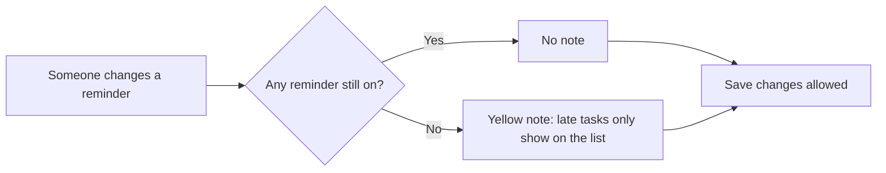

# Settings — Behavior

> Each person's own settings: the name the team sees next to their tasks and comments, the email address reminders go to, and which reminders the app sends at all.

## Who uses it, and when
- **Who**: every person on the team, for themselves only; nobody changes someone else's settings here.
- **When**: once after signing up, then rarely: a new email address, or too many reminders.
- **Goal**: get the reminders that help and silence the ones that do not, without asking anyone.
- **Done when**: the changes are saved and the screen says so.

## Main flow
1. Ben opens Settings from the top bar.
2. He finds the morning summary too much and turns it off; the other two reminders stay on.
3. He presses Save changes. "Saved" appears next to the button, and the next morning no summary arrives.

## Rules
### Profile
**R1.** The name is what the team sees next to tasks and comments. It cannot be left empty: the field says why, and Save changes is greyed until it is filled in.

**R2.** The email must be a whole address, with an at sign and a dot after it. Otherwise the field says so and Save changes is greyed. Every reminder goes to this address.

### Reminders
**R3.** Three reminders, each on or off on its own: when someone gives you a task (right away), a summary every morning at 9:00 with the tasks due that day and the late ones, and a reminder the day before a task given to you is due. A new account starts with all three on.

**R4.** Turning all three off is allowed, but a yellow note under them warns that late tasks will then only show on the list.

### Saving
**R5.** Nothing is kept until Save changes is pressed. After saving, "Saved" shows next to the button until the next change. Leaving the screen without saving loses the changes.

## Situations
| Situation | What happens | Scenario on the board |
|---|---|---|
| A new account | Name and email filled in, all reminders on (R3) | default |
| Every reminder turned off | The yellow note, saving still allowed (R4) | reminders-off |
| The email is missing its at sign | The field explains, Save changes is greyed (R2) | — |
| The name is wiped out | The field explains, Save changes is greyed (R1) | — |
| A change, then leaving without saving | The change is lost (R5) | — |

## Open questions
1. Should leaving with unsaved changes ask first?
2. Is 9:00 right for everyone, or should each person choose the time of the morning summary?
3. Should reminders also come as phone notifications, or is email enough?
