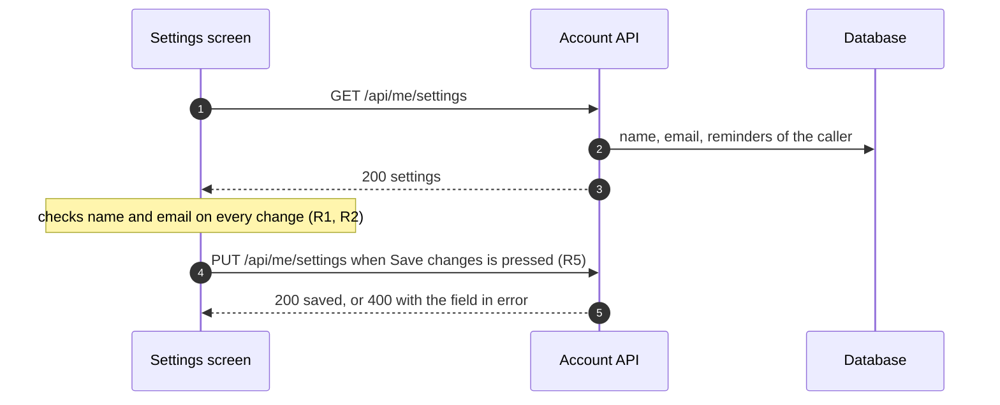
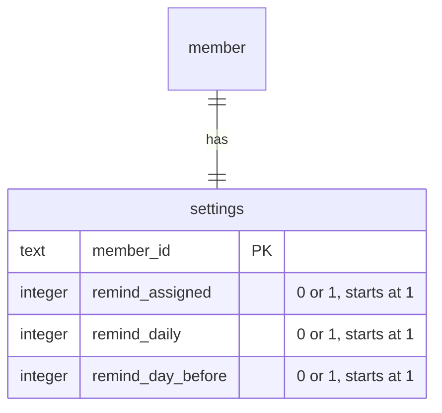

# Settings — Technical

- **Status**: designed, not built yet. This tab says how the screen is meant to be built and where each rule lives in the board's own code.
- **Rule numbers**: the same R1…R5 as the Behavior tab.
- **Board code**: `boards/screens/settings.tsx`, the person signed in is `ME` in `boards/_kit/fixtures.ts`.

## Code map

### Loading and saving
The screen loads the caller's own settings once and sends them back whole on Save; nothing is sent while typing.

### Parts of the board
| Part | Where | Role |
|---|---|---|
| Screen | `Settings` in `boards/screens/settings.tsx` | Profile card, reminders card, Save |
| Reminder list | `REMINDERS` in the same file | Label and help of each reminder |
| Scenarios | `SCENARIOS` in the same file | Which reminders are on |

## API (planned)
| Method and path | Body | Answer |
|---|---|---|
| `GET /api/me/settings` | — | `200 { name, email, reminders: { assigned, daily, dayBefore } }` |
| `PUT /api/me/settings` | the same shape | `200` saved; `400 { field }` when the name is empty (R1) or the email is not an address (R2) |

The server checks name and email again: the screen's checks only spare a round trip. The daily summary is sent by a job at 9:00 in each person's time zone (R3).

## Data

## Rules in code
- **R1** — `nameError` when the trimmed name is empty; shown under the field, and Save changes is `disabled`.
- **R2** — `emailError` from a simple check (something, an at sign, a dot after it); the field's hint says where reminders go.
- **R3** — `REMINDERS` draws one `Checkbox` per reminder; `SCENARIOS.default` has all three on, as a new account does.
- **R4** — `allOff` shows a warning note (`role="status"`); it never disables Save.
- **R5** — `saved` turns on with Save changes and off again with any change (`change` wraps every setter).

## Scenarios ↔ code
| Scenario | Data | Branch in the board |
|---|---|---|
| default | all three reminders on | No note |
| reminders-off | all three off | `allOff` → warning note (R4) |
