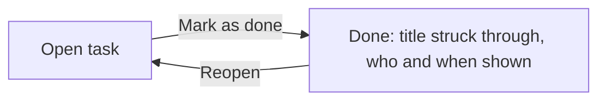

# Task detail — Behavior

> One task on its own screen: who does it and by when, the notes that explain it, a checklist of small steps and the comments of the team. From here the task is marked as done, or opened again.

## Who uses it, and when
- **Who**: anyone on the team; the person doing the task uses it most.
- **When**: when a title on the list is not enough, to read the notes, follow the steps or ask a question.
- **Goal**: everything about one task in one place, so nobody has to ask in a chat what was meant.
- **Done when**: the steps are ticked, the question in the comments has an answer, and the task is marked as done.

## Main flow
1. Chen opens "Book a room for the quarterly planning" from the list. The date is red: it was due yesterday.
2. He reads the notes, ticks the step he finished and sees "2 of 3 done" at the top of the checklist.
3. He writes in the comments that the second quote is on its way and presses Send.
4. When the room is booked he presses Mark as done. The title is struck through and the screen says who finished it and when.

## Rules
### The top of the screen
**R1.** The top shows the title, whether the task is open or done, and one main button: Mark as done while it is open, Reopen once it is done. A done task has its title struck through and says who finished it and when.

**R2.** Under the title: the person doing the task (or "No one yet"), the date with the same colours as on the list (red when the day has passed, orange when it is today, grey when it is later or the task is done), and who wrote the task. The notes follow, when there are any.

What the main button does (R1):

### Checklist and comments
**R3.** The checklist holds the small steps of the task, ticked one by one; its header says how many are done. Ticking the last step does not finish the task: only the main button does.

**R4.** Comments are listed oldest first, each with the writer's name and the time.

**R5.** A comment is written in the box under the comments and sent with Send or Enter. It appears at the bottom with the writer's name and "Just now". While the box is empty Send is greyed.

### Deleting
**R6.** Delete task sits at the bottom of the screen, small and red, far from the main button so it is not pressed by mistake. Deleting removes the task for the whole team.

## Situations
| Situation | What happens | Scenario on the board |
|---|---|---|
| A task that is late | Red date, Mark as done offered (R1, R2) | open-task |
| A task already done | Title struck through, who and when, Reopen offered (R1) | done-task |
| Every step ticked but the work is not over | The task stays open until someone presses Mark as done (R3) | — |
| Someone presses Send with an empty box | Nothing is sent (R5) | — |
| A task with no checklist | The checklist is not shown at all (R3) | — |

## Open questions
1. Should deleting ask first, or offer an undo for a few seconds?
2. Should the person doing the task hear about new comments, and how: an email, or only a mark on the list?
3. Should ticking the last step offer to mark the whole task as done?
