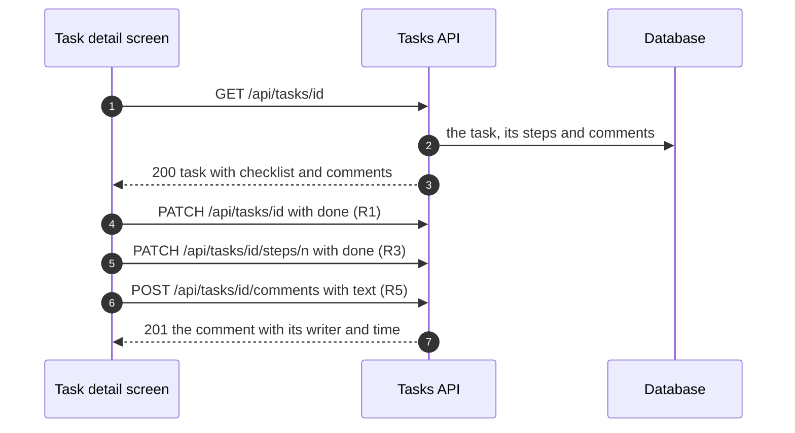
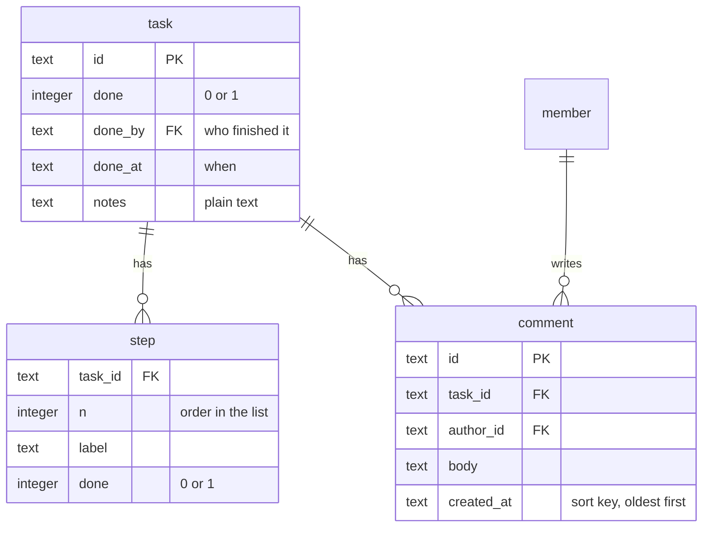

# Task detail — Technical

- **Status**: designed, not built yet. This tab says how the screen is meant to be built and where each rule lives in the board's own code.
- **Rule numbers**: the same R1…R6 as the Behavior tab.
- **Board code**: `boards/screens/tasks/detail.tsx`, fake data in `boards/_kit/fixtures.ts` (`OPEN_TASK`, `DONE_TASK`).

## Code map

### When the screen opens
One request brings the task with its checklist and comments; every change after that sends one small request.

### Parts of the board
| Part | Where | Role |
|---|---|---|
| Screen | `TaskDetail` in `boards/screens/tasks/detail.tsx` | Scenario data, main button, cards |
| Label and value | `Field` in the same file | One line of the who and when card |
| Fake data | `OPEN_TASK`, `DONE_TASK` in `boards/_kit/fixtures.ts` | The two scenarios |

## API (planned)
| Method and path | Body | Answer |
|---|---|---|
| `GET /api/tasks/:id` | — | `200 { task }` with `checklist[]` and `comments[]`, comments oldest first (R4) |
| `PATCH /api/tasks/:id` | `{ done: boolean }` | `200 { task }`; setting `done` also records `done_by` and `done_at` (R1) |
| `PATCH /api/tasks/:id/steps/:n` | `{ done: boolean }` | `200 { step }`; never changes the task's own `done` (R3) |
| `POST /api/tasks/:id/comments` | `{ text }`, 1 to 2000 characters | `201 { comment }`; empty text → `400` (R5) |
| `DELETE /api/tasks/:id` | — | `204`; the task leaves everyone's list (R6) |

## Data

## Rules in code
- **R1** — `done` is local state in `TaskDetail`; the main button switches between Mark as done and Reopen. The title gets `line-through` and the line under it shows `doneBy` when done.
- **R2** — the who and when card: `Avatar` and name, or "No one yet"; the date uses `dueTone` from the fixtures, forced to `neutral` once done; then `notes`.
- **R3** — `checklist` state; the card header counts the ticked steps. Ticking never touches `done`.
- **R4** — comments drawn in the order they are stored, oldest first.
- **R5** — `comment` trims the text, ignores an empty one and appends `{ by: ME, at: "Just now" }`. Send is `disabled` while the box is empty.
- **R6** — a small `danger` button at the bottom of the page.

## Scenarios ↔ code
| Scenario | Data | Branch in the board |
|---|---|---|
| open-task | `OPEN_TASK`: late, one step of three done, two comments | `done` false → Mark as done, red date |
| done-task | `DONE_TASK`: done, every step ticked | `done` true → struck-through title, Reopen, grey date |
