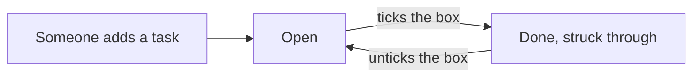
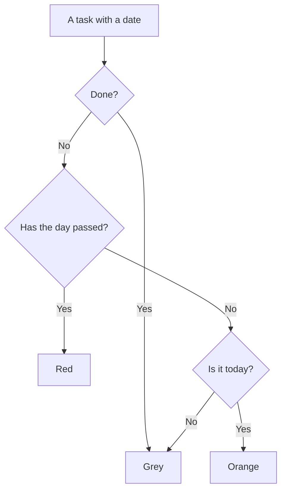

# Task list — Behavior

> The first screen after signing in: everything the team has to do, on one shared list. People add a task in one line, tick it off when it is done, and filter the list to see only what is still open.

## Who uses it, and when
- **Who**: everyone on the team, with the same list for all; there are no private tasks.
- **When**: at the start of the day to plan it, and whenever something new comes up during the day.
- **Goal**: get a task out of your head and onto the shared list in a few seconds, then see at a glance what is still open and who is on it.
- **Done when**: every open task has a person on it, and nothing late is left without a word in its comments.
- This screen only lists tasks. Details, checklists and comments are on the task's own screen.

## Main flow
1. Ana signs in and lands on Team tasks: the line under the title says how many tasks are open and how many are done.
2. She types "Draft the welcome email" into the box at the top and presses Enter. The task appears first in the list, with her initials on it and no date.
3. Later she finishes a task and ticks its box. The title is struck through and greyed, and the counts change at once.
4. Before the weekly meeting she picks Open, so only the tasks still to do are shown, each with its date and its person.
5. She clicks a task's title to open it, read the comments and add the missing details.

## Rules
### Adding and ticking off
**R1.** Everyone sees the same list: every task of the team, whoever wrote it and whoever does it.

**R2.** A new task is written in one line and added with Enter or the Add button. It goes to the top of the list, is given to the person who wrote it, and has no date yet. While the box is empty the Add button is greyed and nothing is added.

**R3.** Ticking the box marks the task as done: the title is struck through and greyed, and the task stays where it is in the list. Unticking it opens the task again.

A task moves between two situations only, and anyone on the team can move it (R3):

### What a row shows
**R4.** Above the list, three filters: All, Open and Done, each with the number of tasks it holds. Choosing one shows only those tasks. The numbers follow every tick at once, and so does the line under the title.

**R5.** A task with a date shows it next to the title: red when the day has passed, orange when it is today, grey when it is later. Once the task is done its date turns grey whatever the day. A task without a date shows none.

**R6.** The initials of the person doing the task sit at the end of the row. A task nobody has taken yet says "No one yet", so it is easy to spot in a meeting.

**R7.** Clicking a task's title opens the task on its own screen. Clicking the box only ticks it and never opens it.

Which colour a date gets (R5):

### Empty and long lists
**R8.** A team with no tasks at all sees a short invitation to add the first one, in place of the list. The filters only appear once there is a task.

**R9.** Every task is on one page, the newest first. A long list makes the page scroll: nothing is cut off and there is no button to load more.

## Situations
| Situation | What happens | Scenario on the board |
|---|---|---|
| A normal day: some tasks open, some done, one late | Late date in red, today's in orange, done tasks struck through (R3, R5) | few-tasks |
| A brand new team | The invitation to add the first task, no filters (R8) | empty |
| A busy week with more tasks than fit on a screen | The page scrolls, the counts cover every task (R4, R9) | many-tasks |
| Someone presses Enter with an empty box | Nothing is added (R2) | — |
| A task is ticked by mistake | Unticking it opens it again, in the same place (R3) | — |
| Open is chosen and the last open task is ticked | The list says everything is done (R4) | — |
| A task has no person on it | The row says "No one yet" (R6) | — |

## Open questions
1. Should finished tasks move to the bottom, or disappear after a few days, instead of staying where they are?
2. Do people need their own view, with only the tasks given to them, next to the whole team's list?
3. Should a new task ask for a date and a person straight away, or is one line enough and the details come later?
4. When two people tick the same task at the same moment, is it enough that the last one wins?
