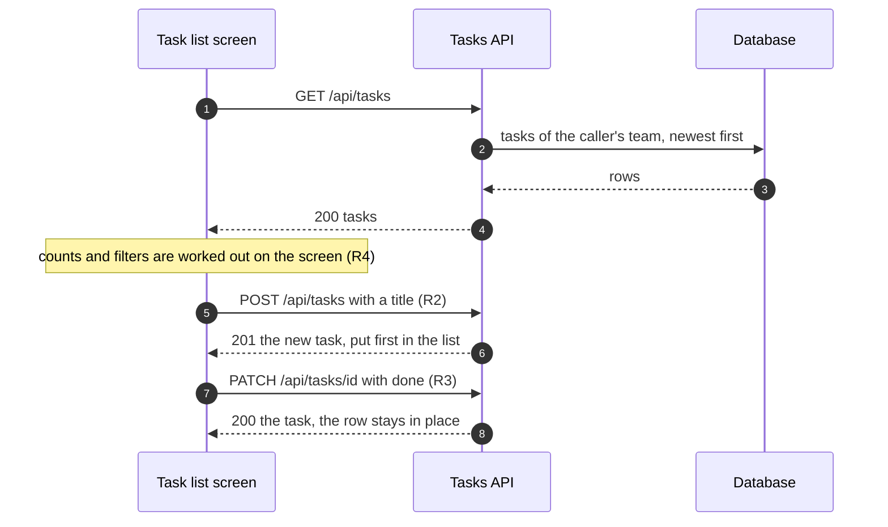
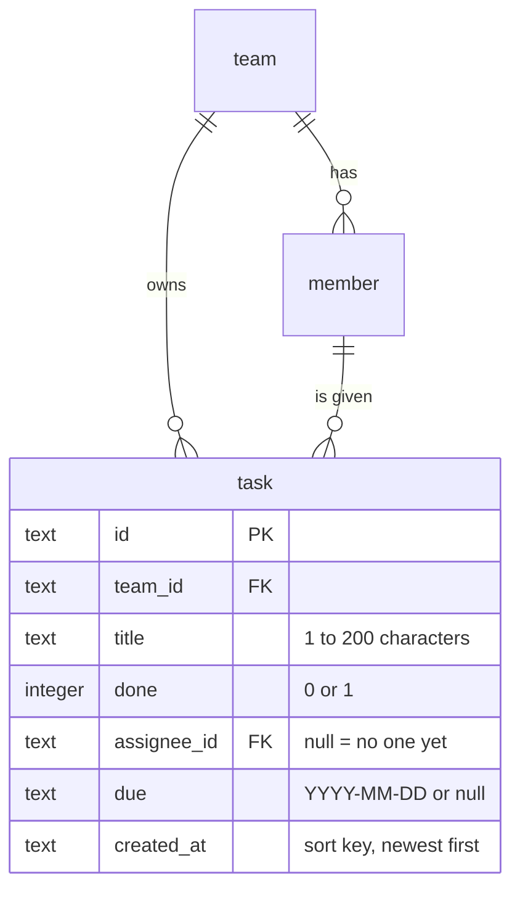

# Task list — Technical

- **Status**: designed, not built yet. There is no app code to point at: this tab says how the screen is meant to be built (the API and data it needs) and where each rule lives in the board's own code.
- **Rule numbers**: the same R1…R9 as the Behavior tab.
- **Board code**: `boards/screens/tasks/list.tsx`, fake data in `boards/_kit/fixtures.ts`, the top bar in `boards/_kit/Shell.tsx`.

## Code map

### When the screen opens
One request loads the whole list; ticking and adding change one task each and update the list in place.

### Parts of the board
| Part | Where | Role |
|---|---|---|
| Screen | `TaskList` in `boards/screens/tasks/list.tsx` | Scenario data, add form, filters, list |
| Row | `TaskRow` in the same file | Box, title link, date, initials |
| Top bar | `Shell` in `boards/_kit/Shell.tsx` | App name, sections, person signed in |
| Initials | `Avatar` in `boards/_kit/Avatar.tsx` | Coloured circle per person |
| Fake data | `FEW_TASKS`, `MANY_TASKS`, `dueTone` in `boards/_kit/fixtures.ts` | The scenarios' tasks and the date colours |

## API (planned)
| Method and path | Body | Answer |
|---|---|---|
| `GET /api/tasks` | — | `200 { tasks: Task[] }`, newest first, every task of the caller's team (R1, R9) |
| `POST /api/tasks` | `{ title }`, 1 to 200 characters after trimming | `201 { task }` with `assignee` = caller and `due` = null (R2); empty title → `400` |
| `PATCH /api/tasks/:id` | `{ done: boolean }` | `200 { task }`; position in the list unchanged (R3) |

No paging: a team keeps a few hundred tasks at most, and one request is simpler than a "load more" button (R9).

## Data

The colour of a date is worked out on the screen from `due` and today's date in the viewer's time zone: `dueTone` in the fixtures stands for it (R5).

## Rules in code
- **R1** — the list is per team, not per person: `GET /api/tasks` filters on the caller's team only. On the board every scenario shows the whole team's tasks.
- **R2** — `add` in `TaskList`: trims the text, ignores an empty one, puts the task first with `assignee: ME` and `due: null`. The Add button is `disabled` while the box is empty.
- **R3** — `toggle` flips `done` in place (`map`, no re-sorting). `TaskRow` strikes the title through with `line-through` and greys it.
- **R4** — `count` is computed from the tasks on every change; `FILTERS` draws the three buttons with `aria-pressed`. The filter is a choice on the screen, not saved.
- **R5** — `dueTone`: overdue → `danger`, today → `warning`, later → `neutral`; a done task always gets `neutral`.
- **R6** — `Avatar` with the person's initials, or the text "No one yet" when `assignee` is null.
- **R7** — the title is a link to `/tasks/:id` (the Task detail screen); the checkbox is a separate control.
- **R8** — `tasks.length === 0` replaces the filters and the list with the invitation card.
- **R9** — one `ul` with every task; the page scrolls.

## Scenarios ↔ code
| Scenario | Data | Branch in the board |
|---|---|---|
| few-tasks | `FEW_TASKS`: six tasks, two done | The full list: rows, filters, counts |
| empty | `[]` | `tasks.length === 0` → invitation card (R8) |
| many-tasks | `MANY_TASKS`: thirty-six tasks | The same rows; the page scrolls (R9) |
