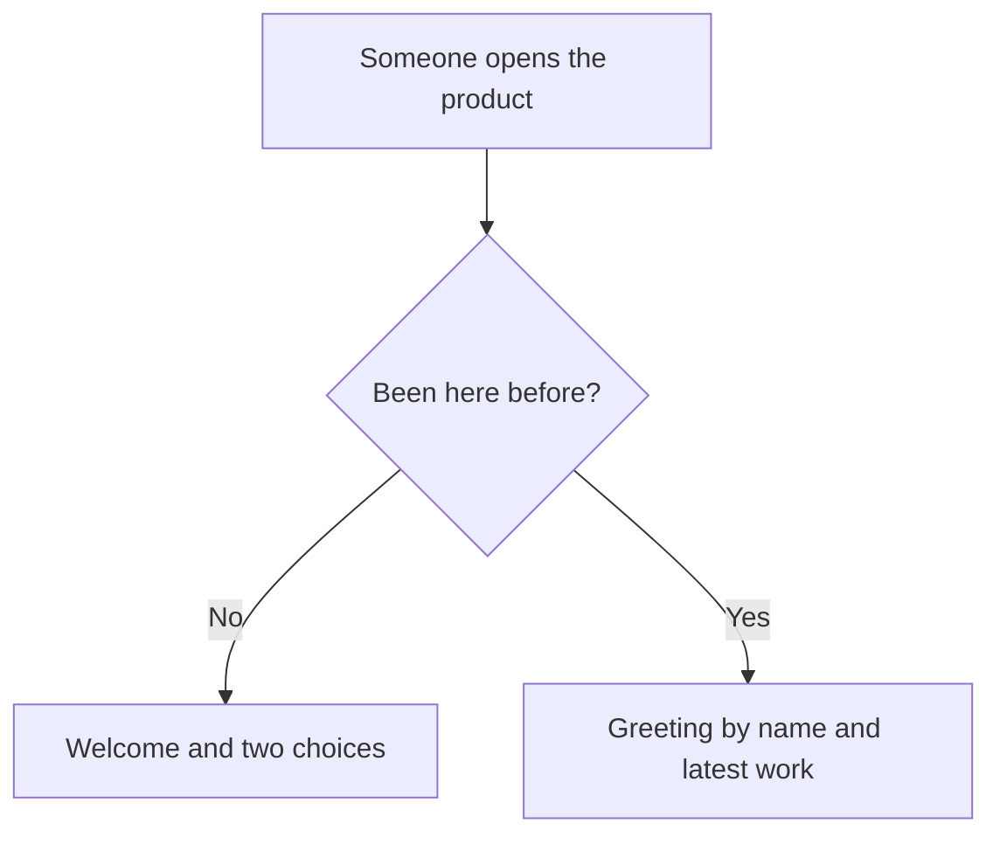

# Welcome — Behavior

> The first screen of the product. Newcomers learn what it is for and get started; people who come back go straight to their latest work.

## Who and when
- **Who**: anyone who opens the product.
- **When**: on the first visit, and every time someone comes back.
- **Done when**: a newcomer has chosen to create an account or to sign in; someone coming back has opened one of their recent pieces of work.

## Main flow
1. The screen opens with a one-line promise of what the product does.
2. A newcomer chooses **Create an account** or **I already have an account**.
3. Someone coming back is greeted by first name and sees the three pieces of work they changed last.

## Rules
**R1.** A newcomer always sees both choices: create an account, or sign in.

**R2.** Someone coming back is greeted by first name.

**R3.** The list shows at most three pieces of work, newest first, each with when it was last changed.

## Situations
| Situation | What happens | Scenario on the board |
|---|---|---|
| First visit | Welcome and two choices | first-visit |
| Coming back | Greeting and latest work | returning |
| Coming back, nothing made yet | Greeting only | not drawn yet |

## Open questions
1. Should someone coming back also see a way to start something new?
